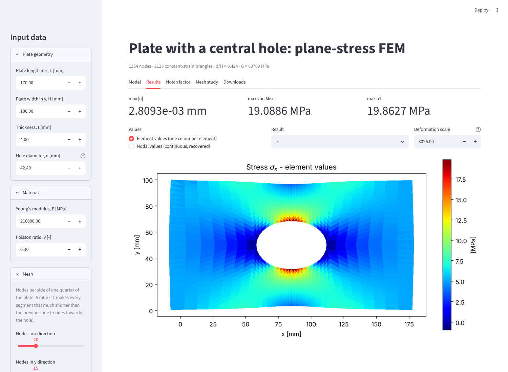
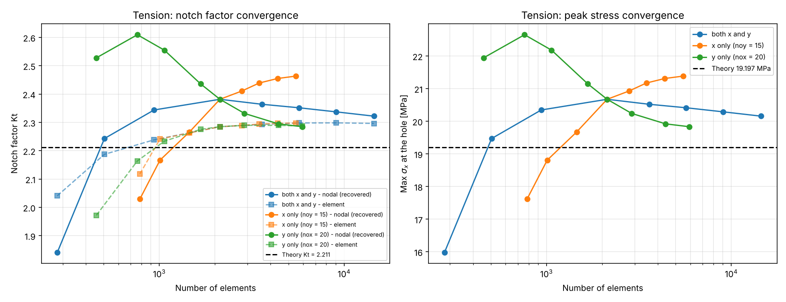
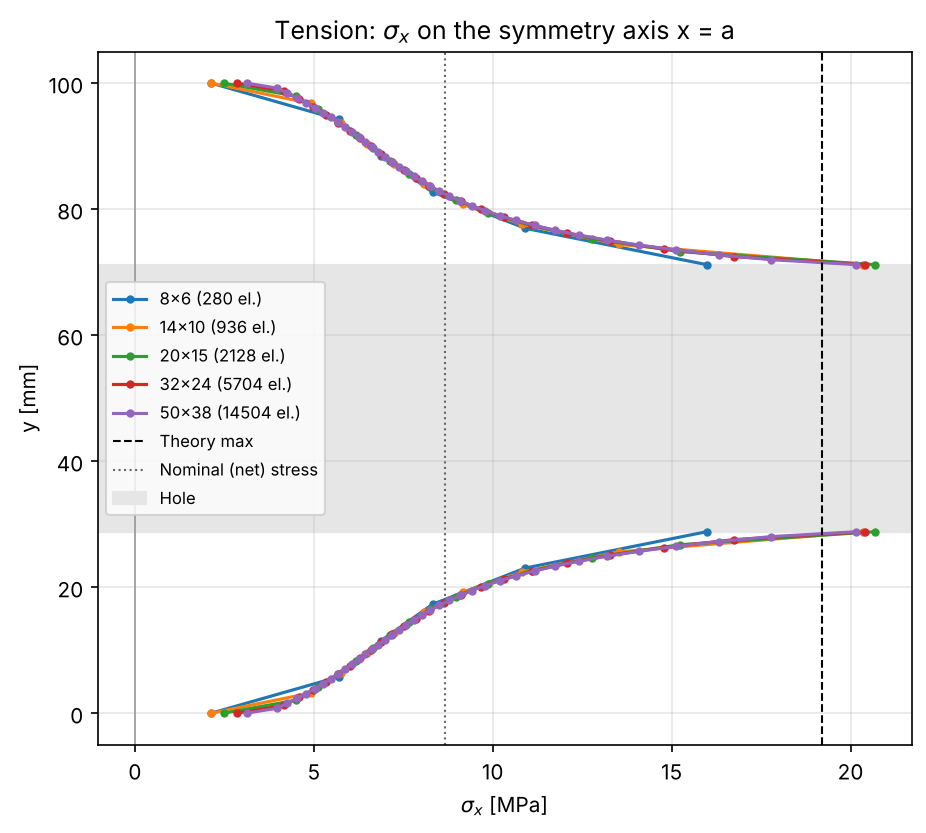
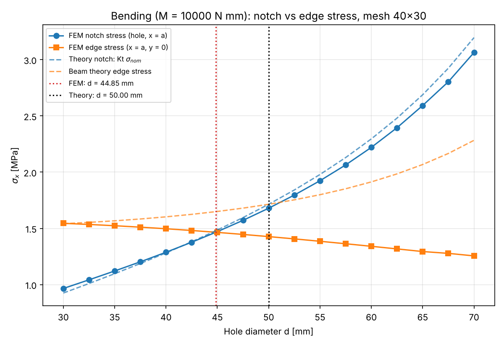
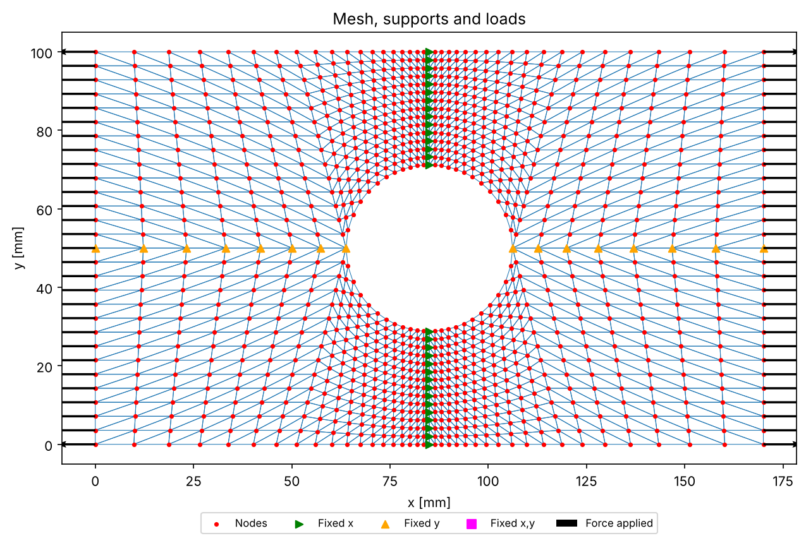
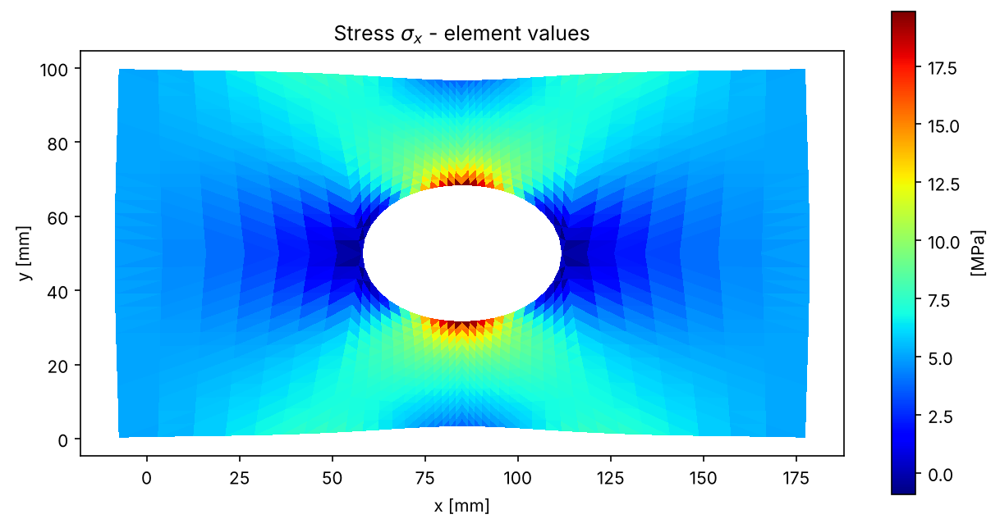
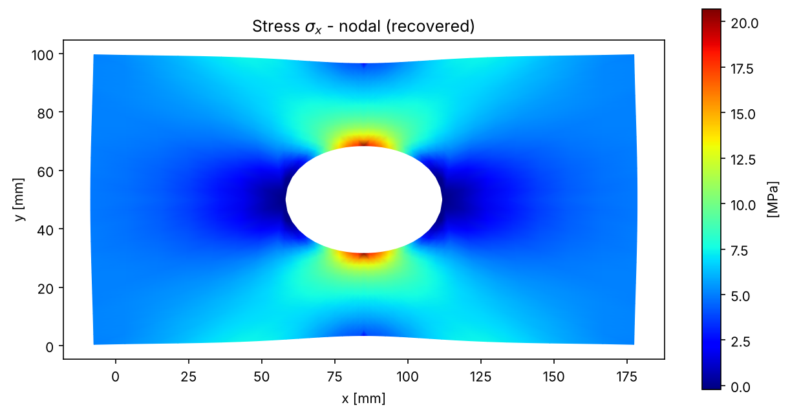
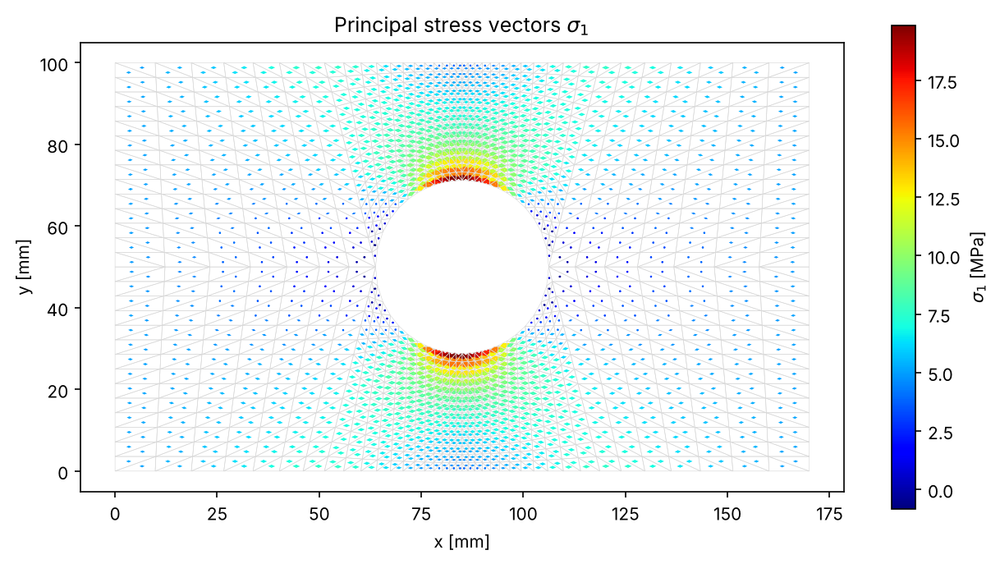

# platefem: FEM analysis of a plate with a central hole

[](../../actions/workflows/tests.yml)

`platefem` is a finite element program for a **plane-stress rectangular plate with a central
circular hole**, built on **constant-strain triangles (CST)**. It:

* meshes the plate automatically, with the mesh refined towards the hole;
* solves **pure tension** and **pure in-plane bending**;
* computes displacements, strains, stresses, principal stresses and von Mises stress;
* evaluates the **notch (stress-concentration) factor Kt** and compares it with theory;
* runs **mesh sensitivity studies**.

You can use it as a **web app (Streamlit)**, an **interactive terminal program**, a
**command-line tool** or a **Python library**.



---

## Inputs

All inputs are physical quantities. Units are N, mm and MPa.

| Input | Symbol | Default |
|---|---|---|
| Plate length (x direction) | L | 170 mm |
| Plate width (y direction) | H | 100 mm |
| Plate thickness | t | 4 mm |
| Diameter of the central hole | d | 42.4 mm |
| Young's modulus | E | 210000 MPa (steel) |
| Poisson ratio | ν | 0.3 |
| Nodes per quarter side, x / y | nox / noy | 20 / 15 |
| Spacing ratio, x / y (< 1 refines towards the hole) | rx / ry | 0.9 / 1.0 |
| Load case | | tension or bending |
| Tensile force | P | 2000 N |
| Bending moment | M | 10000 N·mm |

The shear modulus is computed as G = E / (2(1 + ν)).

## Installation

```bash
git clone https://github.com/<user>/fem-plate-hole.git
cd fem-plate-hole
pip install -e .          # core: numpy, scipy, matplotlib
pip install -e .[app]     # + streamlit, plotly (web app)
pip install -e .[dev]     # + pytest
```

Python 3.10 or newer is required.

## Usage

### 1. Web app (Streamlit)

```bash
streamlit run streamlit_app.py
```

**Deploy online for free:** push this repository to GitHub, go to
[share.streamlit.io](https://share.streamlit.io), choose **Create app**, select the repository
and branch, and set the main file to `streamlit_app.py`. The dependencies are installed from
`requirements.txt`.

The app has five tabs:

* **Model**: the mesh with its supports and loads. Select nodes with the box or lasso tool,
  by clicking, or by typing node ids. You can then fix u_x and/or u_y on them or apply nodal
  forces, and reset to the default supports and loads at any time.
* **Results**: element values (one colour per element, with a fringe bar) or recovered nodal
  values (continuous colouring) on the deformed shape. Available results: displacements, εx, εy,
  γxy, σx, σy, τxy, von Mises, principal stress vectors σ1 and σ2, and σx on the symmetry axis.
* **Notch factor**: σnom and Kt from the element values and from the recovered nodal values,
  compared with theory.
* **Mesh study**: the convergence, symmetry-axis and diameter-search studies described below.
* **Downloads**: every result file in one zip.

### 2. Interactive terminal program

```bash
platefem            # or: python -m platefem
```

This walks through three stages:

1. **Preprocessor**: asks for plate geometry, material, mesh, load case and supports. Press
   Enter to accept the default shown in brackets. It then shows the model. You can keep the
   default supports and loads, or click nodes on the figure (single nodes, or every node inside
   a box) to define your own.
2. **Solver**: assembles and solves the model and writes the result files.
3. **Postprocessor**: shows the deformed plate and lets you pick results from a menu, prints
   the notch factor, then optionally recovers nodal values for continuous plots and a more
   accurate Kt.

Every figure is also saved as a PNG in `results/figures/`.

### 3. Command line

```bash
platefem run --load tension --magnitude 2000                  # P = 2000 N
platefem run --load bending --magnitude 10000 -d 50           # M = 10000 N·mm, d = 50 mm
platefem run -L 200 -H 80 -t 5 -d 30 -E 70000 --nu 0.33       # aluminium plate
platefem run --nox 40 --noy 30 --rx 0.95 -o fine              # finer mesh, output in ./fine

platefem preprocess ...   # single stages, communicating through text files
platefem solve
platefem postprocess --show
```

| Option | Meaning |
|---|---|
| `-L/--length`, `-H/--width`, `-t/--thickness`, `-d/--diameter` | geometry [mm] |
| `-E/--youngs-modulus`, `--nu/--poisson` | material |
| `--nox`, `--noy`, `--rx`, `--ry` | mesh |
| `--load {tension,bending}`, `--magnitude` | load case |
| `--supports {symmetric,clamped}` | supports for tension |
| `--method {elimination,penalty}` | how supports are applied |
| `-o/--out`, `--prefix` | output folder and file prefix |

### 4. Mesh sensitivity study

```bash
platefem study -o study            # about 10 s; add --quick for small meshes only
```

This writes PNG figures and CSV tables for:

1. **Convergence** of Kt and of the peak stress with the number of elements. The mesh is
   refined in both directions together, in x only and in y only, and compared with theory.
2. **σx distribution on the vertical symmetry axis** for several mesh densities.
3. **Bending, hole-diameter search**: the diameter d where the stress at the hole equals the
   stress at the plate edge of the same section, compared with theory (Kt·d = H).

| Convergence (tension) | σx on the symmetry axis | Notch vs edge stress (bending) |
|---|---|---|
|  |  |  |

### 5. Python library

```python
from platefem import PlateData, LoadCase, generate_mesh, apply_load_case, solve, notch_factor

plate = PlateData.from_dimensions(length=170, width=100, t=4, d=42.4, E=210000, v=0.3)
load  = LoadCase("bending", 10000)
mesh  = generate_mesh(plate.a, plate.b, plate.d, nox=20, noy=15, ratio_x=0.9, ratio_y=1.0)
F, BC = apply_load_case(mesh, plate, load)
res   = solve(mesh, F, BC, plate.E, plate.v, plate.t)
print(notch_factor(mesh, plate, load, res).summary())
```

See [`examples/api_example.py`](examples/api_example.py).

| Mesh, supports and loads | σx, element values | σx, recovered nodal values | Principal stresses σ1 |
|---|---|---|---|
|  |  |  |  |

---

## Method

**Meshing** (`mesh.py`).

* The plate occupies [0, L] × [0, H], with the hole centred at (L/2, H/2). It is split into
  four quadrilateral sub-regions, one per quarter.
* The lower-left quarter is bounded by the bottom edge, the left edge, and a top side made of
  a straight part on y = H/2 plus the quarter arc of the hole.
* It is meshed with `noy × nox` nodes. Points on each side follow a geometric spacing, where
  every segment is `ratio` times the previous one, and each grid cell is split into two
  triangles.
* The quarter is mirrored about both symmetry lines, and the nodes on those lines are shared.

**Loads and supports** (`loads.py`). Edge tractions are converted to consistent nodal forces
by integrating the linear shape functions along the loaded edges.

* **Tension.** A uniform traction P/(H·t) is applied on the ends.
  * `symmetric` (default): both ends are loaded, u_x = 0 on x = L/2 and u_y = 0 on y = H/2.
  * `clamped`: the load is applied at x = 0, u_x = 0 along x = L, and u_y = 0 at its middle.
* **Bending.** A linear traction σx = −M(y − H/2)/I with I = H³t/12 is applied on both ends.
  Supports: u_x = 0 on x = L/2, and u_y = 0 at (L/2, 0) and (L/2, H).
* In the app and the interactive program, supports and loads can also be set on any node.

**Solver** (`solver.py`).

* Each element uses the CST strain-displacement matrix B and the plane-stress matrix
  D = E/(1−ν²)·[[1, ν, 0], [ν, 1, 0], [0, 0, (1−ν)/2]].
* The element stiffness is Ke = t·A·BᵀDB. Element matrices are assembled into a sparse global
  K.
* Supports are applied by exact elimination of the fixed DOFs (default) or by a penalty on the
  diagonal.
* Outputs: displacements u, reactions R = K·u − F, strains ε = Bu, stresses σ = Dε, principal
  stresses σ1,2 with the direction of σ1, and von Mises σvm = √(σx² − σxσy + σy² + 3τxy²).

**Postprocessing** (`postprocess.py`).

* Nodal values are area-weighted averages of the element values. On the net section x = L/2,
  where the peak stress occurs, they come instead from a least-squares patch recovery: a
  quadratic fit to the centroid values of the surrounding elements.
* Nominal stresses:
  * tension: σnom = P / (t(H − d))
  * bending: σnom = 6Md / ((H³ − d³)t)
* Kt = σmax / σnom.
* Theory (Peterson):
  * tension: Kt = 3 − 3.14(d/H) + 3.667(d/H)² − 1.527(d/H)³
  * bending: Kt ≈ 2 (for d/H ≲ 0.65)

**Result files** (`io.py`). Each stage writes comma-separated text files with one header line:
`*_Nodes_Plate.txt`, `*_Elements_Plate.txt`, `*_data_Plate.txt`, `*_Displacement_Plate.txt`,
`*_Reactions_Plate.txt`, `*_Strains_Plate.txt`, `*_Stresses_Plate.txt` and
`*_NotchFactor.txt`.

## Example results (default inputs, d/H = 0.424)

Mesh 20 × 15 nodes per quarter (2128 elements), rx = 0.9:

| Load | σnom [MPa] | Kt element | Kt nodal | Kt theory |
|---|---|---|---|---|
| Tension, P = 2000 N | 8.681 | 2.285 | 2.382 | 2.211 |
| Bending, M = 10000 N·mm | 0.689 | 1.927 | 2.015 | 2.000 |

The finest mesh (50 × 38, 14504 elements) gives **Kt = 2.30 (tension)** and **1.96–1.98
(bending)**. In bending, the stress at the hole equals the stress at the plate edge for
**d ≈ 44.9 mm**. Simple beam theory gives d = H/Kt = 50 mm. Near the hole, the two ligaments
carry the moment like eccentric flanges, so the edge stress stays below the net-section beam
value.

## Tests

```bash
pytest -q
```

The tests cover:

* the mesh and displacements, against a stored reference solution (`tests/data/reference/`);
* load resultants and equilibrium;
* uniform stress far from a small hole;
* agreement between the penalty and elimination methods;
* detection of a singular model;
* file round-trips;
* the CLI, the study, the interactive program and the Streamlit app, end to end.

## Project layout

```
streamlit_app.py  web app
platefem/
  data.py         plate geometry and material
  mesh.py         geometric spacing and mapped mesh generator
  loads.py        load cases and supports
  solver.py       CST stiffness, assembly, solution, stresses
  postprocess.py  nodal recovery, notch factors, theory
  plots.py        figures
  io.py           text files exchanged between the stages
  pipeline.py     non-interactive stages
  interactive.py  interactive terminal program with mouse node picking
  study.py        mesh sensitivity studies
  cli.py          command line
tests/            pytest suite and reference solution
examples/         library usage
```

## License

MIT
